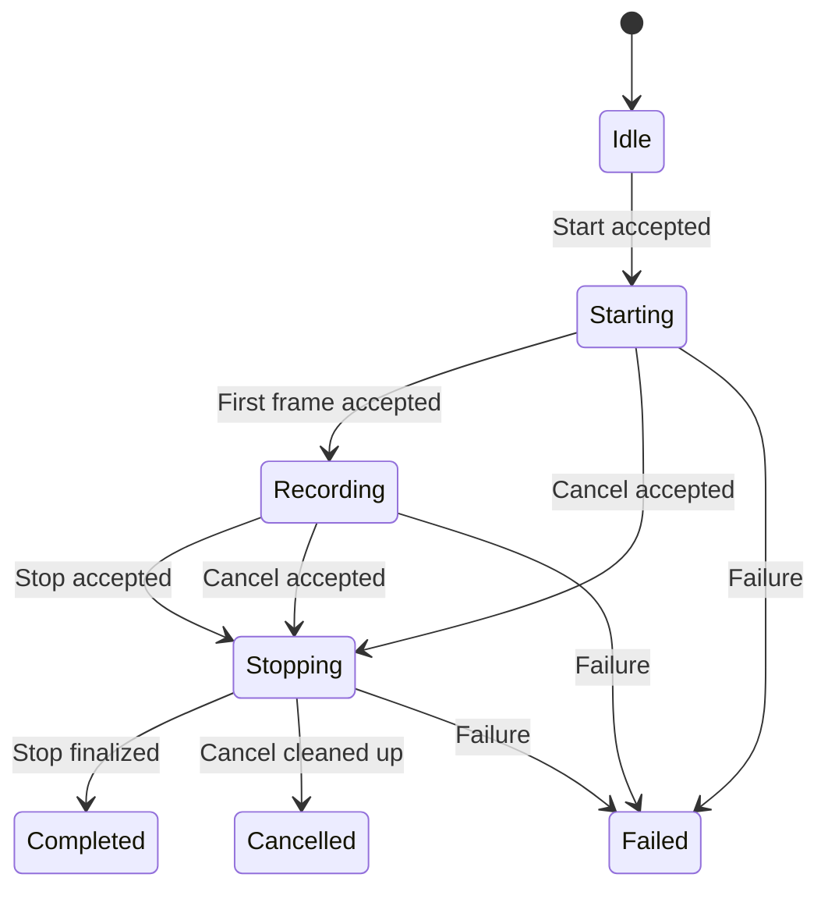

# 屏幕截图与录屏 API 设计

> 状态：Windows/macOS 实施与验证中；截图入口命名已确定为 `ScreenCapturer`
> 适用范围：拟新增的 core 公共接口、六个平台接缝、C ABI 和六种语言绑定
> 核实基准：2026-10-28，对照当前工作区 API 风格、对象模型、事件与绑定所有权规范

截图与录屏共用 `CaptureSource` 和 `ScreenCaptureOptions`。`ScreenCapturer` 执行
一次截图并返回现有的 `Image`；`ScreenRecorder` 管理一次录制并输出视频文件。
采集目标、授权会话、录制状态各自有明确的生命周期，不向调用方暴露平台原生句柄。

本文定义接口和行为契约，实施状态不能替代逐项验收。代码块用于说明公共设计，完整
声明与英文 Doxygen 以公共头文件为准；平台可用性说明必须与实际验证结果一致。
通用规则服从 [API 风格](api-style.md)、[对象模型](object-model.md)、
[事件系统](event-system.md)、[C ABI](c-abi.md) 和 [句柄所有权](handle-ownership.md)。

## 1. 范围与类型分工

第一版覆盖单显示器、单窗口和单个源内矩形区域的截图与无音轨录屏。截图复用
`Image::SaveToFile` 等现有图片能力；录屏固定为 MP4 容器、H.264 视频、SDR 输出。
当前实施范围是 Windows/macOS；Linux 与移动平台保留相同符号并明确返回不支持。

| 类型 | 职责 | 对象模型 |
|---|---|---|
| `CaptureSource` | 保存一个目标及其可选授权会话 | 无集合 ID 的身份对象，`shared_ptr` |
| `ScreenCapturer` | 能力探测、异步源选择、异步截图 | 不可实例化的静态入口，无句柄 |
| `ScreenRecorder` | 一次录制的状态、停止、取消与结果事件 | 无集合 ID 的身份对象，`shared_ptr` |
| `CaptureSourceSelectionOptions` | 系统选择器的允许目标及父窗口 | 可拷贝值结构 |
| `ScreenCaptureOptions` | 光标及裁剪配置 | 可拷贝值结构 |
| `ScreenRecordingOptions` | 采集配置、帧率及码率 | 可拷贝值结构 |
| `ScreenRecordingEvent` 及派生类 | 录制状态通知和终结结果 | 可拷贝事件值对象 |

不新增 manager、公共资源 ID 或全局录制单例；录制事件直接由对应 recorder 发出。
`ScreenCapturer` 与 `ScreenRecorder` 都表示执行者；`ScreenCaptureOptions` 保留操作名，
不改成 `ScreenCapturerOptions`。

`ScreenCapturer` 不保存可变配置或“最近一张截图”，因此采用静态方法，每次请求显式
传入 source 和 options。`ScreenRecorder` 则持有一次录制的持续状态，必须实例化。
执行者命名不要求两者具有相同的构造方式。

第一版不包含跨屏拼接、多个源合成、窗口枚举与缩略图列表、区域选择遮罩 UI、标注、
滚动截图、暂停/恢复、音频、HDR 文件输出、实时帧回调、直播及持久化授权令牌。
这些能力的后续接口见 §12，不能先加入没有实现语义的配置字段。

## 2. 采集源

拟放在 `core/src/capture_source.h`。以下及后续声明均位于 `namespace nativeapi`。
标准库包含、前向声明和大部分文档注释省略。

```cpp
enum class CaptureSourceType {
  None,     // No usable target is known.
  Display,  // A display target.
  Window,   // A window target.
  Unknown,  // A selected target whose kind the backend cannot identify.
};

class CaptureSource {
 public:
  static std::shared_ptr<CaptureSource> FromDisplay(
      std::shared_ptr<Display> display);
  static std::shared_ptr<CaptureSource> FromWindow(
      std::shared_ptr<Window> window);

  ~CaptureSource();
  CaptureSource(const CaptureSource&) = delete;
  CaptureSource& operator=(const CaptureSource&) = delete;
  CaptureSource(CaptureSource&&) = delete;
  CaptureSource& operator=(CaptureSource&&) = delete;

  CaptureSourceType GetType() const;
  std::string GetName() const;

 private:
  CaptureSource();
  friend class ScreenCapturer;
  friend class ScreenRecorder;
  class Impl;
  std::unique_ptr<Impl> pimpl_;
};
```

### 2.1 创建与目标身份

- `FromDisplay` / `FromWindow` 同步创建目标描述，不请求权限、不弹 UI、不开始采集。
  空参数、已知失效目标或当前后端不支持直接指定该类型时返回 `nullptr`。
- `FromWindow` 接收已有的 `Window` 对象。当前 `WindowManager` 管理本应用窗口；
  捕获其他应用窗口应使用 §3 的 `SelectSource`，不能把外部窗口登记到本应用 manager。
- `SelectSource` 的结果可以只持有平台授权对象或 portal 会话，无须能反查成
  `Display` / `Window`。因此不提供强制返回这两种对象的 getter。
- 每个 `CaptureSource` 表示一次采集目标绑定。分别创建的源可以指向同一窗口，但不
  承诺共享授权或实例去重；它们不是 manager 对原生窗口的重复查询。
- `GetType` 返回绑定的目标类型；目标已知失效时为 `None`。`GetName` 活读当前可取得
  的显示名称，名称不可得或目标失效时返回空字符串。名称不可作为稳定标识。
- 系统已返回目标但没有可靠类型信息时，`GetType` 返回 `Unknown`，不猜测为窗口或
  显示器。它与表示已知失效的 `None` 不同；两者都不是权限查询，实际采集仍可能失败。
- 目标消失不会使 C++ 对象或 C 句柄悬垂。后续操作失败，显示器重新连接也不自动把旧
  source 绑定到新显示器；名称相同不足以认定为同一个目标。

### 2.2 授权、占用与释放

持有 source 不等于永久获准采集。直接指定的源在真正采集时仍可能需要系统授权；
通过选择器取得的源也可能被系统撤销。不能序列化 source 或把原生授权令牌公开给绑定。

同一个 source 在第一版只允许一个在途截图或一个活动录制。截图交付完成前或 recorder
处于 `Starting` / `Recording` / `Stopping` 时，第二个消费者被拒绝，不排队、不抢占。
不同 source 的并发由后端决定，资源不足时按正常失败处理。

在途截图和活动 recorder 保留 source 的强引用。调用方可以释放自己那份引用，而不
打断已受理的操作。终结后消费者释放 source；source 最后一份引用释放时关闭它所持有
的授权会话和原生资源。单纯持有已选 source 在部分系统上就可能保留共享指示器或
portal 流；不再使用时应释放，不应存入长期全局缓存。

`Stop` / `Cancel` 结束本次录制的数据消费和编码，不撤销调用方仍持有的 source 授权。
不同平台对同一 source 的顺序复用能力不同：仅在既有目标和授权仍可使用时复用；
需要重新选源时操作失败，不静默选择替代目标。第一版不承诺跨会话复用。

## 3. 源选择与截图

拟放在 `core/src/screen_capturer.h`，包含 `capture_source.h` 和几何值类型。

```cpp
struct CaptureSourceSelectionOptions {
  bool allow_displays = true;
  bool allow_windows = true;
  std::shared_ptr<Window> parent_window;
};

struct ScreenCaptureOptions {
  bool include_cursor = false;
  bool crop_enabled = false;
  Rectangle crop = {0, 0, 0, 0};
};

class ScreenCapturer {
 public:
  static bool IsSupported();
  static bool IsSourceSelectionSupported();
  static bool IsDirectCaptureSupported(CaptureSourceType type);

  static void SelectSource(
      const CaptureSourceSelectionOptions& options,
      std::function<void(bool, std::shared_ptr<CaptureSource>)> callback);

  static void Capture(
      std::shared_ptr<CaptureSource> source,
      const ScreenCaptureOptions& options,
      std::function<void(bool, std::shared_ptr<Image>)> callback);

 private:
  ScreenCapturer() = delete;
};
```

### 3.1 能力查询

能力查询无 UI、无权限申请、无实际采集。它们反映当前后端和宿主可用性，不保证权限、
目标存活、文件可写或之后一定成功。

| 查询 | `true` 的含义 |
|---|---|
| `ScreenCapturer::IsSupported()` | 当前存在至少一种可用截图路径 |
| `IsSourceSelectionSupported()` | 当前可发起交互选源，允许类型仍受后端限制 |
| `IsDirectCaptureSupported(type)` | 当前支持按已知对象直接指定该类型；`None` / `Unknown` 恒为 false |
| `ScreenRecorder::IsSupported()` | 当前具备至少一种采集路径及本规范要求的编码、封装路径 |

模块可用不等于每种参数组合可用。请求的光标、目标类型、码率等无法兑现时必须失败，
不能把窗口截屏变成整个桌面截屏、无光标变成带光标、录屏变成单张图片。

### 3.2 选择器契约

选择器只允许返回一个源。两个 `allow_*` 都为 false 属于无效参数。允许类型是可选范围，
不是要求平台同时具备两类源；实际展示范围为允许类型与后端能力的交集。交集为空失败。
系统返回允许范围之外的类型时失败，不能扩大采集范围。

若后端无法限制选择范围，也无法可靠识别所选类型，则只接受两个 `allow_*` 都为 true
的请求，成功时 source 类型为 `Unknown`。只允许一种类型的请求在打开 UI 前失败，
不能忽略过滤条件。`Unknown` 仅表示类型信息缺失，不允许选中第一版范围外的其他源。

`parent_window` 为选源 UI 的父窗口，不是被采集的窗口。空值时优先使用当前可用宿主
窗口；后端必须提供父窗口而无法解析时失败。父窗口由请求持有到结束；原生窗口在
请求期间关闭时使请求失败，并清理或忽略迟到的系统结果。

进程内最多一个在途 `SelectSource`。重复请求立即走失败完成路径，不打断已有选择器。
该静态接口没有程序化取消方法；用户可在系统 UI 中取消。请求必须由用户操作发起，
不因能力探测、对象构造或后台轮询自动弹出选择器。

| 结果 | 回调 |
|---|---|
| 选择成功 | `true, source` |
| 用户正常取消选择器 | `true, nullptr` |
| 参数无效、功能不支持、系统拒绝访问或选择器失败 | `false, nullptr` |

只有系统明确报告正常取消时才返回 `true, nullptr`；无法区分的拒绝按失败处理。
用户取消不是异常，绑定的异步便利接口应保留可空结果。

### 3.3 截图契约

`Capture` 获取调用受理后的一个新有效帧，不返回上次调用的缓存。成功为
`true, image`；所有失败为 `false, nullptr`。空 source、源被占用、授权拒绝、目标消失、
不支持的选项、无效裁剪、获取帧或图片转换失败均不返回部分结果。

返回的 `Image` 持有独立像素内容。源关闭、录制结束或底层缓冲池复用不影响已交付图片。
截图本身不保存文件，也不隐式写剪贴板；调用方组合现有 `Image` / `Clipboard` API。

不增加 `GetLastError`、C++ 异常或模块专属的结果包装。更细的机器可读失败原因需要先
解决 [API 风格 §4](api-style.md#4-失败怎么表达) 的统一错误模型；当前 bool 契约无法
区分截图授权失败与其他截图错误，这一限制是明确的。

## 4. 坐标、画面与格式

### 4.1 裁剪

`crop` 的单位是**采集源图像的物理像素**，原点在该图像左上角，x 向右、y 向下。
它描述图像区域，不是窗口位置或全局 screen coordinates，不能直接传入
`Window::GetBounds()` 或显示器的逻辑坐标。

- `crop_enabled == false` 时完全忽略 `crop`；捕获整个源，包含当前光标策略。
- 开启时四个分量必须有限且为整数值，x/y 非负，width/height 为正；右边界和下边界
  必须在当前有效源图像内。尽管 `Rectangle` 字段是 double，也不接受小数或 NaN。
- 不自动舍入、夹取或改成全屏。校验在获得实际帧尺寸后完成，溢出也按无效参数处理。
- 先规范图像朝向，再裁剪，最后执行录制输出缩放或像素补齐。裁剪不以桌面全局原点为准。
- 多 DPI 显示器分别作为独立源。应用需要从逻辑坐标换算时必须使用该源实际的映射，
  不允许假定全桌面共享一个缩放系数。

源为窗口时，采集原生后端提供的窗口画面，不用桌面矩形截取来冒充窗口采集。装饰、
阴影、最小化窗口和被遮挡窗口的可用性依赖后端，实施时须在公共注释中逐平台注明。
第一版不提供统一的“仅内容区”开关，也不承诺捕获系统禁止采集的内容。

### 4.2 光标与颜色

`include_cursor` 控制光标是否合入像素；默认 false。后端不能提供请求的模式时失败。
录屏没有单独的光标轨，裁剪范围外的光标不出现在结果里。

第一版交付 SDR 图像/视频。HDR 输入必须经明确的 SDR 转换，不能直接截断高动态范围
通道造成错误画面；后端不能正确转换时失败。具体色彩转换实现和质量验证见 §12。

### 4.3 大小变化

截图返回该次有效帧经裁剪后的实际像素尺寸，不额外放大或缩小。

录屏以第一个有效帧经裁剪后的尺寸固定编码画布。H.264 所需的偶数尺寸通过右侧/底部
补黑像素获得，不裁掉边缘内容。后续整个源尺寸变化时保持输出画布尺寸，等比缩放并
居中补黑边，不拉伸。启用裁剪时区域始终使用相同的源像素坐标；源缩小导致区域越界
则失败，不悄悄移动裁剪区域。

## 5. 录屏接口与事件

拟放在 `core/src/screen_recorder.h`，引用共用的 `ScreenCaptureOptions`。

```cpp
enum class ScreenRecordingState {
  Idle,
  Starting,
  Recording,
  Stopping,
  Completed,
  Cancelled,
  Failed,
};

struct ScreenRecordingOptions {
  ScreenCaptureOptions capture;
  double frame_rate = 30.0;
  size_t video_bitrate = 0;  // Bits per second; zero selects automatically.
};

class ScreenRecordingEvent : public Event {
 public:
  std::string GetTypeName() const override;
};

class ScreenRecordingStartedEvent : public ScreenRecordingEvent {
 public:
  std::string GetTypeName() const override;
};

class ScreenRecordingCompletedEvent : public ScreenRecordingEvent {
 public:
  ScreenRecordingCompletedEvent(const std::string& file_path, double duration);
  std::string GetFilePath() const;
  double GetDuration() const;
  std::string GetTypeName() const override;
  // Private immutable event payload omitted.
};

class ScreenRecordingCancelledEvent : public ScreenRecordingEvent {
 public:
  std::string GetTypeName() const override;
};

class ScreenRecordingFailedEvent : public ScreenRecordingEvent {
 public:
  explicit ScreenRecordingFailedEvent(const std::string& message);
  std::string GetMessage() const;
  std::string GetTypeName() const override;
  // Private immutable event payload omitted.
};

class ScreenRecorder : public EventEmitter<ScreenRecordingEvent> {
 public:
  static bool IsSupported();

  ScreenRecorder();
  ~ScreenRecorder() override;
  ScreenRecorder(const ScreenRecorder&) = delete;
  ScreenRecorder& operator=(const ScreenRecorder&) = delete;
  ScreenRecorder(ScreenRecorder&&) = delete;
  ScreenRecorder& operator=(ScreenRecorder&&) = delete;

  bool Start(std::shared_ptr<CaptureSource> source,
             const std::string& file_path,
             const ScreenRecordingOptions& options);
  bool Stop();
  bool Cancel();

  ScreenRecordingState GetState() const;
  bool IsActive() const;
  double GetDuration() const;
  std::string GetFilePath() const;

 private:
  class Impl;
  std::unique_ptr<Impl> pimpl_;
};
```

事件名称就是 `GetTypeName()` 返回的字符串。事件负载按值保存，不通过 recorder 活读
来还原历史结果。事件归属于订阅的 recorder，不增加 `ScreenRecorderId`。
失败诊断文本供日志和展示使用，允许平台差异，不能通过解析文本实现业务分支。

`frame_rate` 必须有限且在 `[0.1, 240]` 内，表示目标最大采样帧率；实际帧率受源刷新、编码和负载
限制，不保证恒定帧率，不为静止画面强制复制每一帧。媒体时间戳仍覆盖静止时间。
`video_bitrate` 为目标 bit/s，取值不超过 `UINT32_MAX`，0 交由后端选择，
不是最终文件平均码率的精确承诺。
后端不能接受非零配置时失败，不静默忽略。

## 6. 状态机与动作语义



`Stopping` 同时覆盖保存收尾和取消清理；内部记录进入原因，不新增对外的取消中状态。

| 操作 | 允许状态 | 同步返回与后续结果 |
|---|---|---|
| `Start` | `Idle` | true 后立即为 `Starting`，稍后开始或失败 |
| `Stop` | `Recording` | true 后立即为 `Stopping`，稍后完成或失败 |
| `Cancel` | `Starting` / `Recording` | true 后立即为 `Stopping`，稍后取消或失败 |
| 重复/不合法操作 | 其他状态 | false，不改变状态、不产生新的结果事件 |

### 6.1 受理与失败

`Start` 同步检查当前状态、非空 source、源占用、基本选项和路径形式等已知条件。
同步拒绝返回 false，对象保持 `Idle`，可修正参数重试，不发 `FailedEvent`。
需要实际授权、拿到帧、打开文件或创建编码器才能知道的错误，在受理后通过
`ScreenRecordingFailedEvent` 报告。

进入 `Recording` 的条件是首个有效视频帧已被编码管线接受，不是选择器关闭或权限
申请通过。每次成功受理的录制最多一个 `StartedEvent`；在 `Starting` 取消或失败时没有
开始事件。`Stop` 在 `Starting` 返回 false，此时终止请求应使用 `Cancel`。

一个 recorder 只执行一次成功受理的录制。到达 `Completed` / `Cancelled` / `Failed`
后不能重启；下一次录制新建对象。这避免迟到的回调混入下一次录制。

### 6.2 完成、取消与竞态

- `Stop` 停止接收新帧，排空已接收编码任务，封装并关闭文件，成功发布目标文件后才
  进入 `Completed`。之后才可播放或上传最终文件。
- `Cancel` 停止采集、丢弃待编码内容并清理本次临时输出；不保留半成品。
  清理失败进入 `Failed`，诊断中说明残留，不虚报 `Cancelled`。
- `Stopping` 不再接受 `Cancel`，也不接受第二次 `Stop`；避免提交文件和删除文件竞争。
- 系统撤销授权、目标消失或平台采集失败都进入 `Failed`，不伪装成用户主动取消或
  正常保存结束，也不自动切换目标。
- 状态转换由共享逻辑串行裁决。若取消先被接受，后端因这次取消产生的“流关闭”属于
  取消清理；独立的写入/清理错误仍可导致失败。已进入终态后忽略所有迟到结果。

对象和宿主运行时仍存活时，每次被接受的录制恰好提交一个终结事件：Completed、
Cancelled、Failed 三选一。事件按发生顺序交付，先更新状态再通知，开始事件不会
排在终结事件之后。回调读取到的是当前状态，可能已经比某个排队事件更晚。
有无监听器都不影响采集、状态推进或文件收尾。

### 6.3 getter 与析构

- `IsActive()` 在 `Starting` / `Recording` / `Stopping` 为 true，其余为 false。
- `GetDuration()` 单位秒，非负；尚无有效帧时为 0。活动期间为已接受媒体的时长，
  不含等待授权的时间；完成时等于最终媒体时长。取消/失败保留终止时已录制时长供
  诊断，不表示存在可用文件。
- `GetFilePath()` 在受理前为空，受理后返回请求的目标绝对路径，终态保留；只有
  `Completed` 保证该路径在完成时已发布可用输出。它从不返回临时文件路径。
- 析构首先 `ShutdownEmitter()`，撤销异步生产者并停止消费；未完成录制按丢弃处理，
  不尝试靠析构自动保存。与正在进行的发布操作串行裁决：已经发布完成的文件不能
  再删除，尚未发布的任务不得在析构后发布。
- 析构后不派发结果事件，宿主/绑定运行时关闭也不承诺继续交付。清理只能保留内部
  操作上下文，不能回调已销毁的对象；不能等待一个必须由当前 UI 线程执行的回调。

调用方必须持有 recorder 到显式停止/取消完成，不能依靠 GC finalizer 保存录屏。

## 7. 文件输出契约

`file_path` 必须是非空、无内嵌 NUL 的 UTF-8 绝对本地文件路径，扩展名为 `.mp4`
（忽略大小写）；父目录必须存在且可写。第一版不创建目录、不接受 URI、不弹保存框。
最终路径已存在时失败，包含符号链接等已有目录项，绝不覆盖调用方原有内容。

写入使用目标同目录中独占创建的临时文件。最终提交采用平台支持的不覆盖发布操作，
发布时再次保证目标不存在；不能用“先检查，再普通覆盖 rename”的竞态实现替代。
后端/文件系统不能提供所需保证时失败。临时文件命名是内部细节，不能成为公共 API。

`CompletedEvent` 仅在编码、封装、文件关闭和最终发布全部成功后发出。没有有效帧不能
发布空视频。成功不承诺断电后数据仍持久化；进程崩溃可能留下临时文件，后续恢复机制
不属于第一版。正常失败或取消应清理本次临时文件，清理错误如实报告，不触碰已有文件。

## 8. 线程、回调与资源所有权

所有接受 options 的操作在调用时复制值配置，并保留所需共享对象。调用方在返回后修改
原结构不影响请求。非空回调是异步方法的前置条件；空回调不启动操作，也不弹 UI。

第一版控制操作和 getter 在宿主 UI 线程调用，绑定负责切换到该线程，不宣称任意线程
可并发操作 recorder。像素采集、转换、编码与 I/O 在内部工作线程执行；不在 UI 线程
等待首帧或文件封装。内部帧队列必须有界，过载按时间戳丢帧，不能无限积压内存。

宿主 dispatcher 正常运行时，选择/截图完成与录制事件总在后续 UI 循环交付，不在
发起调用的栈上重入；同一回调只执行一次。交付前释放本次 source 的占用，允许截图
回调里发起下一次操作，保留必要强引用直到回调交付结束。

未初始化宿主或 dispatcher 明确不可用时，能力探测返回 false，`Start` 同步返回 false；
`SelectSource` / `Capture` 的非空回调在调用线程同步收到失败，不启动任何平台工作。
这是异步交付的明确例外，与现有宿主初始化约束一致。宿主在处理中退出时撤销回调并
清理资源，不向已销毁的语言运行时调用完成或 release 函数。

录制监听是观察已有操作，不通过 `StartEventListening` / `StopEventListening` 启停
录制。高频帧不进入公共事件系统。source 和图片的回调负载使用现有交付 lease；绑定
复制值并 retain 需要保留的句柄后再确认释放，不能把缓冲池地址交给异步消费者。

## 9. 使用示例

以下是接口实现后的 C++ 用法；路径由应用确定，例子只展示调用顺序。

```cpp
auto source = CaptureSource::FromDisplay(
    DisplayManager::GetInstance().GetPrimary());

ScreenCaptureOptions options;
options.include_cursor = false;
ScreenCapturer::Capture(source, options, [](bool success, auto image) {
  if (!success) return;
  bool saved = image->SaveToFile("/tmp/screenshot.png");
  // Handle saved == false separately from capture failure.
});
```

```cpp
// Keep recorder in application state until its terminal event.
auto recorder = std::make_shared<ScreenRecorder>();
recorder->AddListener<ScreenRecordingCompletedEvent>(
    [](const ScreenRecordingCompletedEvent& event) {
      auto path = event.GetFilePath();
      auto seconds = event.GetDuration();
      // The finalized file is now available.
    });
recorder->AddListener<ScreenRecordingFailedEvent>(
    [](const ScreenRecordingFailedEvent& event) {
      auto message = event.GetMessage();
      // Display or log the diagnostic; do not parse it as an error code.
    });

CaptureSourceSelectionOptions selection;
ScreenCapturer::SelectSource(selection, [recorder](bool success, auto source) {
  if (!success || !source) return;
  ScreenRecordingOptions options;
  options.capture.include_cursor = true;
  bool accepted = recorder->Start(source, "/tmp/recording.mp4", options);
  // Handle !accepted; source is retained internally only if accepted.
});

// Later, from a UI action after StartedEvent:
// recorder->Stop();  // Wait for CompletedEvent or FailedEvent.
// To discard while Starting or Recording: recorder->Cancel().
```

## 10. 平台后端与可用性

下表区分本轮实施路径与后续候选后端，**不表示所有平台已通过验收**。运行时仍须探测
实际能力、权限和编码器，公共方法在六个平台上具有相同签名。

| 平台 | 拟采用的路径 | 第一阶段边界 |
|---|---|---|
| macOS | macOS 14+ ScreenCaptureKit；AVAssetWriter H.264/MP4 | 实施中；授权与系统选源不能混同于永久许可 |
| Windows | Windows 10 2004+ Windows.Graphics.Capture；Media Foundation H.264/MP4 | 实施中；处理父 HWND、设备丢失及大小变化 |
| Linux / Wayland | 后续候选：ScreenCast Portal + PipeWire；独立编码/封装管线 | 本轮桩实现；未来系统选源不承诺直接指定 `Display` / `Window` |
| Linux / X11 | 后续候选：独立直接采集后端；可用时使用 portal 选源 | 本轮桩实现；窗口采集不能用桌面区域冒充 |
| Android | 第一阶段桩实现 | 探测 false、工厂 nullptr、动作失败；后续需宿主及 MediaProjection 会话设计 |
| iOS | 第一阶段桩实现 | 探测 false、工厂 nullptr、动作失败；后续按目标 OS/SDK 与应用场景设计 |
| OpenHarmony | 第一阶段桩实现 | 探测 false、工厂 nullptr、动作失败；后续核对公开 SDK 和宿主接缝 |

Wayland 的 ScreenCast Portal 在启动会话时选源，返回 PipeWire 流；源的位置/大小元数据
可能缺失，且不一定等于像素坐标。因此授权源不能强制映射为本库 Display，也不能依赖
一个全局逻辑坐标矩形实现全部捕获。[ScreenCast Portal 文档](https://flatpak.github.io/xdg-desktop-portal/docs/doc-org.freedesktop.portal.ScreenCast.html)

Windows.Graphics.Capture 支持显示器和窗口的帧采集，帧缓冲及其底层 surface 有明确的
生命周期；图片必须在归还缓冲前取得独立内容，不能跨语言保留借用地址。
[Windows Screen Capture 文档](https://learn.microsoft.com/en-us/windows/apps/develop/media-authoring-processing/screen-capture)

核对公开接口后，`GraphicsCapturePicker` 没有源类型过滤参数，`GraphicsCaptureItem`
公开的名称、大小与关闭事件也不能可靠反推出目标类型。因此本设计规定该 picker 路径
使用 §3.2 的双类型允许规则，返回 `Unknown`；直接指定窗口或显示器时类型仍然已知。
这是根据公开接口作出的设计取舍，不能以窗口标题或图像尺寸猜测类型。
[GraphicsCapturePicker](https://learn.microsoft.com/en-us/uwp/api/windows.graphics.capture.graphicscapturepicker)、
[GraphicsCaptureItem](https://learn.microsoft.com/en-us/uwp/api/windows.graphics.capture.graphicscaptureitem)

macOS 以 ScreenCaptureKit 的屏幕采集能力作为候选后端，具体截图、选择器和输出 API
按部署版本确定。[Apple ScreenCaptureKit 文档](https://developer.apple.com/documentation/screencapturekit)

Android 后续接入不能承诺复用一次授权来创建任意多个采集会话；MediaProjection 文档
要求每个会话取得用户同意，并规定 token 的单次使用约束。
[Android MediaProjection 文档](https://developer.android.com/media/grow/media-projection)

## 11. C ABI、绑定与代码组织

实施时拟新增以下公共头：

- `core/src/capture_source.h`：源类型和身份对象。
- `core/src/screen_capturer.h`：选择选项、采集选项与静态入口。
- `core/src/screen_recorder.h`：录制选项、状态、事件和 recorder。

状态机、选项校验、事件顺序、占用裁决及文件发布契约尽量放在共享实现。原生授权、
帧资源和编码器状态留在私有 PIMPL / 平台接缝，公开头不包含平台类型、宏或内部入口。
六个平台均须提供符号；未支持的平台是明确桩实现，不能以缺定义代替不支持。

`CaptureSource` 和 `ScreenRecorder` 追加 `IdTypeTag`，不分配公开资源 ID；
`ScreenCapturer` 是静态工具类，不创建实例句柄。三个新 options 都按值结构跨 C ABI。
特别验证嵌套的 `ScreenRecordingOptions.capture`、父窗口共享字段、静态工具类及
`shared_ptr` 回调的全部生成结果，不能仅凭头文件可解析就认为六个绑定均已导出。

将公共头加入 `API_HEADERS` 后通过根目录 `./codegen` 驱动 C ABI 和六种绑定，不能
手写生成输出。`ScreenCapturer` 的 C 函数前缀应为 `native_screen_capturer_`，不保留
另一个 `ScreenCapture` 入口或名称兼容别名，因为该 API 尚未发布。

绑定保留源/图片/recorder 的引用所有权，按各自线程模型交付回调。Dart、JS、Python、
C# 可以沿用已有 Future / Promise / awaitable / Task 便利层：选源取消得到 null，截图
失败进入通用失败路径。Rust / Go 首先保留回调形态。所有绑定都必须区分 Start 的
“受理”和 StartedEvent，以及 Stop 的“受理”和 CompletedEvent；不能把 bool 直接
包装成“录屏文件已经保存”的异步结果。

原设计阶段仅保存文档。后续 Windows/macOS 实施已启动，只有公共头、平台代码、
生成器、六绑定与实际采集验收全部完成后，才能将本文状态改为已实施。

## 12. 未决事项与后续扩展

下列事项仍需在实现前或对应扩展启动时定案，不用隐含假设填补：

1. **桌面编码依赖及版本。** 确定 macOS / Windows 的原生编码路径，Linux 采用
   GStreamer、FFmpeg 或其他后端的构建、分发与许可策略；确定最小 OS/SDK 和缺少编码器
   时的探测。不能因截图可用就报告录屏可用。
2. **颜色与可见区域。** 明确 SDR 色彩转换、H.264 色彩元数据、窗口阴影/装饰、受保护
   内容及最小化/锁屏行为的平台注释。平台无法检测受保护内容时，不保证将黑帧识别为
   权限错误；仅对可检测的中断作失败判定。
3. **首帧与启动超时。** 系统选择器等待用户期间不设置隐藏超时。授权后迟迟无首帧、
   编码初始化或封装停滞的超时阈值和内部取消机制须在后端落地时定案；不可无限挂起，
   也不能把静止画面正常无更新误判为故障。
4. **源的显式关闭。** 第一版通过释放 source 结束其授权会话。若语言 finalizer 不及时
   释放或需要复用源的 UI 体验要求显式关闭，再设计 `Close` / 状态查询；不能在没有
   明确跨平台语义时添加 `IsAuthorized` 一类误导性 getter。
5. **统一错误模型。** 第一版仅使用既有 bool/nullptr、失败回调和失败事件。若产品必须
   区分权限、取消、编码器缺失等错误，需要先推进全库错误规范，再同步本接口。
6. **暂停与音频。** 暂停需要排除暂停段的媒体时间轴；音频需要分别定义系统音频与
   麦克风、授权、混音及音画同步，不能简单增加两个开关后宣称跨平台支持。
7. **帧流和预览。** 单独设计帧对象、像素格式、时间戳、缓冲所有权、背压与绑定线程。
   不通过每帧生成一个公共 `Image` 事件来扩充本接口。
8. **移动平台及多源。** 移动端需验证宿主、前台服务/扩展与系统选源约束；多源拼接
   需独立定义布局、各源 DPI 和音视频时钟。第一版的单源接口不承诺这些能力。

实施中待收尾：核对各语言 options 默认值（当前生成器部分绑定使用零值或要求显式
字段，不能将其误认作 C++ 默认配置）；补足选择器、源失效、长时间录制与异步绑定的
端到端验证。这些属于本轮验收缺口，不因基础编译或单个窗口 smoke 通过而视为完成。

## 13. 实施与验收检查单

2026-10-28 已取得的验证证据（不替代以下完整检查单）：

- `core/tests/screen_capture_test.cpp` 在 macOS 和 Windows 通过共享契约测试，包含
  取消与编码失败同时发生时保留独立错误、源独占、析构清理以及不覆盖发布。
- `core/tests/screen_capture_macos_smoke.mm` 与 `screen_capture_windows_smoke.cpp`
  在真实桌面采集测试自身窗口，验证裁剪像素、独立图片、H.264 解码、窗口变大后的
  新画面、固定输出尺寸和静止尾段时长；测试不发送合成输入。Windows 由
  `core/tests/run_capture_windows.ps1` 在交互会话中运行，不能用 session 0 结果替代。
- Windows 后端在源尺寸变化时释放旧帧引用并重新创建采集池与会话，确保静止目标也
  能交付新尺寸的完整帧；编码结束补入带时间戳的尾帧，避免 MFT 丢失静止尾段。
- Rust 的采集对象携带框架链接依赖，原生编译目标与 Rust 部署版本一致。已检查
  最终 Mach-O：不使用采集时无 ScreenCaptureKit load command；使用采集且部署
  目标为 macOS 11 时为 `LC_LOAD_WEAK_DYLIB`。这证明链接方式，不等于旧系统运行测试。
- 已通过代码生成一致性检查，以及 Rust、Dart、C#、JS、Python、Go 的基础编译或
  分析；Rust/JS/Python/Go 另有无 UI 的真实 ABI 嵌套配置和录制拒绝测试。现有测试集
  中的条件性跳过仍是未执行项，不能据此宣称所有绑定异步场景通过。

Flutter 示例 `examples/flutter_screen_capture_example` 已在 macOS 启动，完成系统
选源、2560 × 1440 截图预览和短时 MP4 录制。预览按 Data URI 解析 `Image.ToBase64`
的返回值。2026-10-31 整理 PR 时，以最新 main 为基线重新通过 macOS 原生构建、
共享契约测试、生成器测试及示例静态分析。Windows Flutter 示例仍未实机运行；
示例的 Open / Play 目前受 UrlOpener 仅支持 HTTP/HTTPS 限制，不能打开本地输出。
以上事实不代表下列完整验收已完成。

- [ ] 公共命名使用 `ScreenCapturer` / `ScreenRecorder`，options 使用操作名。
- [ ] 公共头符合 API 风格检查单，六平台说明、单位、失败和生命周期注释齐全。
- [ ] source / recorder 禁拷贝移动、登记 handle tag；静态入口不产生无意义实例。
- [ ] 选源覆盖成功、用户取消、拒绝、父窗口销毁、重复选择和迟到结果；验证类型过滤与 `Unknown`。
- [ ] 截图覆盖独立图片所有权、无效/失效/占用源、无首帧和授权失败。
- [ ] 裁剪覆盖边界、负数、小数、非有限数、溢出、多 DPI 与窗口调整大小。
- [ ] 录制覆盖每个合法转换、重复动作、Starting 取消、Stopping 拒绝取消和终态唯一性。
- [ ] 无监听器时仍能录制和完成；事件顺序、回调重入、析构和运行时关闭安全。
- [ ] 目标不存在/已存在/竞争创建、无写入权限、磁盘满、封装失败、清理失败均验证。
- [ ] Completed 后实际解码视频，检查画面、尺寸、SDR 颜色、时间轴及静止段时长。
- [ ] 原生帧队列有界，长时间录制不会随帧数增长内存；事件不逐帧跨绑定。
- [ ] 桌面后端在真实桌面验证；移动桩符号齐全，未验证的平台不标成已支持。
- [ ] `./codegen` 无新 API 的 skipped，核对 C ABI、六绑定和 API reference 输出。
- [ ] 绑定覆盖异步负载 lease/retain、线程切换、用户取消与热重启/运行时关闭。
- [ ] 实施完成后更新本文状态、核实日期及剩余平台限制，不提前把设计目标标为已实施。
